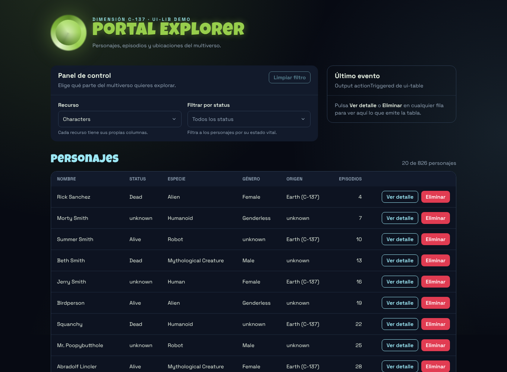
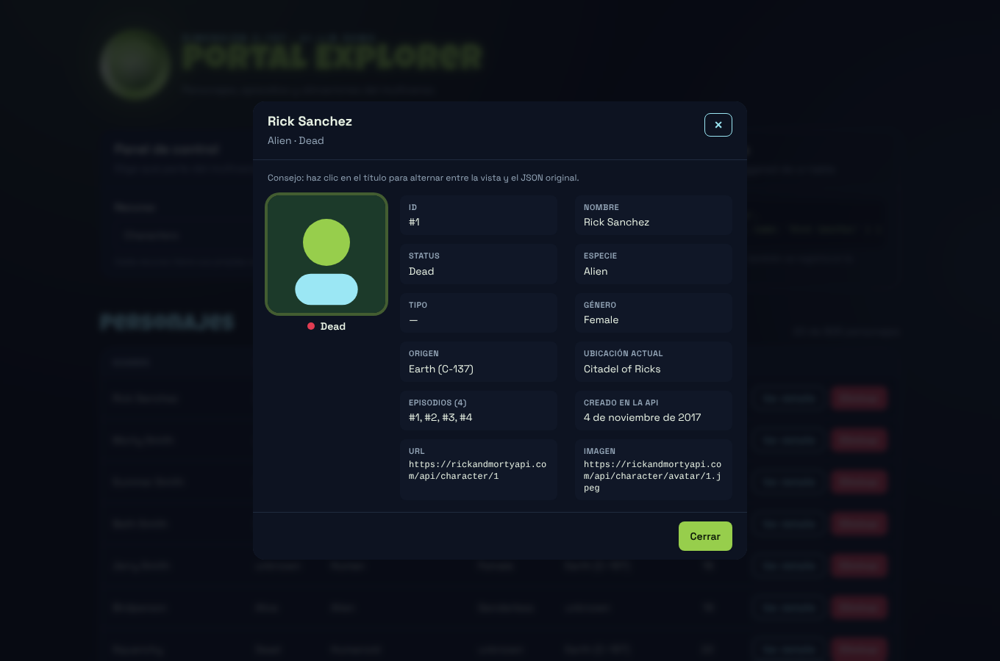
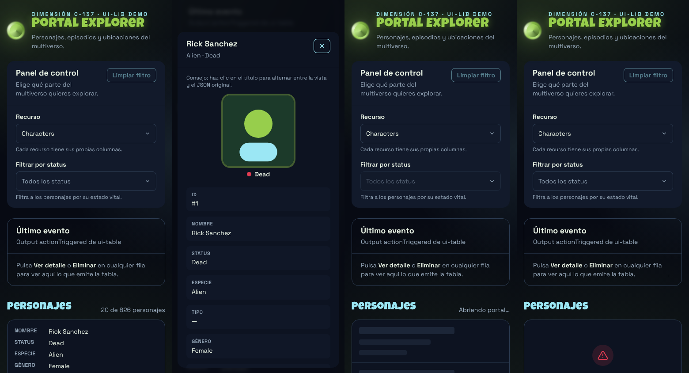

# Portal Explorer · ui-lib

Librería de componentes Angular propia (`ui-lib`) y una aplicación demo (`demo-app`) que la consume para explorar personajes, episodios y ubicaciones de la [Rick and Morty API](https://rickandmortyapi.com/documentation).

> Prueba técnica · Aprendiz / Practicante Frontend Developer
> Autora: **Ariza Hernandez Valery Michell**



**Stack:** Angular 19 · TypeScript (`strict`) · Tailwind CSS v3.4 · ng-packagr · Jest · Rick and Morty API

---

## Tabla de contenido

1. [Instalación y ejecución](#instalación-y-ejecución)
2. [Arquitectura](#arquitectura)
3. [API de componentes](#api-de-componentes)
4. [Flujo de la demo app](#flujo-de-la-demo-app)
5. [Decisiones de diseño](#decisiones-de-diseño)
6. [Scripts](#scripts)
7. [Bitácora de desarrollo](#bitácora-de-desarrollo)

---

## Instalación y ejecución

Requisitos: **Node.js 18.19+ / 20 / 22** y npm.

```bash
git clone <url-del-repositorio>
cd my-workspace
npm install
ng serve demo-app        # o: npm start
```

Abre <http://localhost:4200>. Si no tienes el Angular CLI global, usa `npx ng serve demo-app`.

Otros comandos:

```bash
npm test                 # pruebas unitarias (Jest)
npm run build:lib        # compila la librería publicable en dist/ui-lib
npm run build            # compila librería + demo app
```

---

## Arquitectura

```
my-workspace/
├── projects/
│   ├── ui-lib/                      ← Librería de componentes (publicable con ng-packagr)
│   │   ├── tailwind-preset.js       ← Tokens de color del tema (se publica con el paquete)
│   │   └── src/
│   │       ├── public-api.ts        ← ÚNICO punto de entrada público
│   │       └── lib/
│   │           ├── button/          ← ui-button  (+ types + spec)
│   │           ├── card/            ← ui-card    (+ types + spec)
│   │           ├── select/          ← ui-select  (+ types + spec)
│   │           ├── table/           ← ui-table   (+ types + spec)
│   │           └── spinner/         ← ui-spinner (utilidad interna)
│   └── demo-app/                    ← App que consume la librería
│       └── src/app/
│           ├── core/
│           │   ├── models/          ← Character, Episode, Location, ApiPage<T>…
│           │   ├── services/        ← RickAndMortyApiService (único con HttpClient)
│           │   └── state/           ← ExplorerStore (estado con signals)
│           ├── features/explorer/   ← Página principal, configuración de columnas y vistas de detalle
│           └── shared/components/   ← Modal y la ilustración del portal
├── tailwind.config.js
├── jest.config.js
├── angular.json
└── package.json
```

### Cómo se relacionan las capas

```
ExplorerPageComponent ──lee signals──▶ ExplorerStore ──usa──▶ RickAndMortyApiService ──HTTP──▶ API
        │                                    ▲
        │ usa ui-select / ui-table /         │ setResource(), setStatus(),
        │ ui-card / ui-button                │ nextPage(), removeRecord()…
        └──────────── llama métodos ─────────┘
```

- **ui-lib** no sabe nada de Rick and Morty. Solo recibe datos por `input()` y avisa por `output()`.
- **ExplorerStore** es la única fuente de verdad del flujo: recurso activo, filtro, página, registros, `loading` y `error`. Expone signals de solo lectura (`asReadonly()`) y métodos para cambiarlos.
- **RickAndMortyApiService** es el único archivo que usa `HttpClient`. Los componentes nunca hacen peticiones.

### Convenciones aplicadas

| Convención | Cómo se cumple |
| --- | --- |
| Standalone + OnPush | Todos los componentes (librería y demo) son `standalone: true` con `ChangeDetectionStrategy.OnPush`. |
| Signals API | Solo `input()`, `input.required()`, `output()` y `model()`. No hay ningún `@Input()` / `@Output()`. |
| Prefijo propio | Todos los selectores de la librería usan `ui-` (configurado también en `angular.json`). La demo usa `app-`. |
| Public API limpia | La demo importa siempre desde `'ui-lib'`, nunca desde rutas internas. `tsconfig.json` resuelve `ui-lib` → `projects/ui-lib/src/public-api.ts`. |
| Tipado estricto | `strict: true` + `strictTemplates`. Cero `any` en todo el proyecto. |

---

## API de componentes

### Tema (requisito para usar la librería)

Los componentes usan colores semánticos (`bg-ui-primary`, `text-ui-text`…) que leen variables CSS. La app que consume la librería:

1. Añade el preset y escanea los archivos de la librería en su `tailwind.config.js`:

   ```js
   module.exports = {
     presets: [require('ui-lib/tailwind-preset')],
     content: ['./src/**/*.{html,ts}', './node_modules/ui-lib/**/*.mjs'],
   };
   ```

2. Define (opcionalmente) sus colores en formato `R G B`:

   ```css
   :root {
     --ui-color-primary: 151 206 76;
     --ui-color-surface: 7 10 19;
     /* … ver projects/demo-app/src/styles.css para la lista completa */
   }
   ```

   Si una variable no se define, se usa un valor por defecto neutro.

### `<ui-button>`

| Tipo | Nombre | Tipo TS | Default | Descripción |
| --- | --- | --- | --- | --- |
| `input()` | `label` | `string` | `''` | Texto visible del botón. |
| `input()` | `variant` | `'primary' \| 'secondary' \| 'danger'` | `'primary'` | Estilo visual. |
| `input()` | `size` | `'sm' \| 'md' \| 'lg'` | `'md'` | Tamaño. |
| `input()` | `disabled` | `boolean` | `false` | Bloquea la interacción. Acepta el atributo sin valor. |
| `input()` | `loading` | `boolean` | `false` | Muestra un spinner inline y bloquea el click. |
| `input()` | `type` | `'button' \| 'submit' \| 'reset'` | `'button'` | Atributo `type` nativo. |
| `input()` | `fullWidth` | `boolean` | `false` | Ocupa todo el ancho. |
| `input()` | `ariaLabel` | `string \| null` | `null` | Etiqueta accesible alternativa. |
| `output()` | `clicked` | `void` | — | Solo se emite si no está `disabled` ni `loading`. |
| `ng-content` | — | — | — | Contenido opcional antes del label (p. ej. un icono). |

```html
<ui-button label="Guardar" variant="primary" size="md" [loading]="saving()" (clicked)="save()" />
<ui-button label="Cancelar" variant="secondary" (clicked)="close()" />
<ui-button label="Eliminar" variant="danger" size="sm" disabled />
```

### `<ui-card>`

| Tipo | Nombre | Tipo TS | Default | Descripción |
| --- | --- | --- | --- | --- |
| `input.required()` | `title` | `string` | — | Título del header. |
| `input()` | `subtitle` | `string \| null` | `null` | Subtítulo opcional bajo el título. |
| `input()` | `elevation` | `'flat' \| 'raised' \| 'outlined'` | `'raised'` | Estilo visual del contenedor. |
| `input()` | `interactiveHeader` | `boolean` | `false` | Da al header cursor, hover, foco por teclado y `role="button"`. |
| `input()` | `titleId` | `string \| null` | `null` | Id del `<h2>`, para `aria-labelledby` en un modal. |
| `output()` | `headerClicked` | `void` | — | Se emite al hacer clic en el header (y con Enter/Espacio si es interactivo). |
| `ng-content` | (default) | — | — | Contenido del body. |
| `ng-content` | `[uiCardHeaderActions]` | — | — | Acciones a la derecha del título. |
| `ng-content` | `[uiCardFooter]` | — | — | Pie de la card; se oculta si está vacío. |

```html
<ui-card title="Rick Sanchez" subtitle="Human · Alive" elevation="raised"
         [interactiveHeader]="true" (headerClicked)="toggle()">
  <p>Contenido del body</p>
  <div uiCardFooter>
    <ui-button label="Cerrar" (clicked)="close()" />
  </div>
</ui-card>
```

### `<ui-select>`

Componente genérico: `SelectComponent<V extends string = string>`. Si las opciones son `SelectOption<'alive' | 'dead'>`, `value` y `selectionChange` quedan tipados con esa unión.

| Tipo | Nombre | Tipo TS | Default | Descripción |
| --- | --- | --- | --- | --- |
| `input()` | `options` | `readonly SelectOption<V>[]` | `[]` | Lista de opciones `{ label, value, disabled? }`. |
| `input()` | `label` | `string` | `''` | Etiqueta visible sobre el select. |
| `input()` | `placeholder` | `string` | `'Selecciona una opción'` | Texto cuando no hay selección. |
| `input()` | `loading` | `boolean` | `false` | Muestra un skeleton con spinner. |
| `input()` | `disabled` | `boolean` | `false` | Bloquea la interacción. |
| `input()` | `hint` | `string \| null` | `null` | Texto de ayuda bajo el select. |
| `input()` | `error` | `string \| null` | `null` | Mensaje de error; pinta el select en rojo y añade `aria-invalid`. |
| `model()` | `value` | `V \| null` | `null` | Two-way binding del valor seleccionado. |
| `output()` | `selectionChange` | `SelectOption<V>` | — | Emite el objeto completo al cambiar. |

```ts
interface SelectOption<V extends string = string> {
  readonly label: string;
  readonly value: V;
  readonly disabled?: boolean;
}
```

```html
<!-- Two-way binding con un signal -->
<ui-select label="Recurso" placeholder="Elige uno" [options]="options" [(value)]="selected" />

<!-- One-way + output (así lo usa la demo, porque el estado vive en el store) -->
<ui-select label="Status" [options]="statusOptions" [value]="store.status()"
           (selectionChange)="store.setStatus($event.value)" />
```

### `<ui-table>`

Componente genérico: `TableComponent<T extends object>`. `T` se infiere de `rows` y `columns`. La tabla no conoce el dominio: solo renderiza columnas y emite acciones.

| Tipo | Nombre | Tipo TS | Default | Descripción |
| --- | --- | --- | --- | --- |
| `input.required()` | `columns` | `readonly TableColumn<T>[]` | — | Definición de columnas `{ key, header, cell?, align? }`. |
| `input()` | `rows` | `readonly T[]` | `[]` | Datos a renderizar. |
| `input()` | `loading` | `boolean` | `false` | Muestra filas skeleton en lugar de datos. |
| `input()` | `emptyMessage` | `string` | `'No hay registros para mostrar.'` | Mensaje cuando `rows` está vacío. |
| `input()` | `errorMessage` | `string \| null` | `null` | Mensaje de error de red visible en la tabla. |
| `input()` | `actions` | `readonly TableActionType[]` | `['view', 'delete']` | Acciones por fila. `[]` oculta la columna. |
| `input()` | `viewLabel` / `deleteLabel` | `string` | `'Ver detalle'` / `'Eliminar'` | Textos de los botones. |
| `input()` | `skeletonRows` | `number` | `6` | Filas skeleton durante la carga. |
| `input()` | `trackBy` | `(row: T) => unknown` | identidad | Clave estable para el `@for`. |
| `input()` | `caption` | `string \| null` | `null` | `<caption>` accesible (oculto visualmente). |
| `input()` | `retryLabel` | `string \| null` | `'Reintentar'` | Botón de reintento en el estado de error. |
| `output()` | `actionTriggered` | `TableAction<T>` | — | Emite `{ action: 'view' \| 'delete', row: T }`. |
| `output()` | `retryRequested` | `void` | — | El usuario pulsó "Reintentar". |
| `ng-content` | `[uiTableEmpty]` | — | — | Ilustración para el estado vacío. |

```ts
interface TableColumn<T> {
  readonly key: Extract<keyof T, string>;   // solo propiedades reales de T
  readonly header: string;
  readonly cell?: (row: T) => string;       // formateo opcional
  readonly align?: 'left' | 'center' | 'right';
}
type TableActionType = 'view' | 'delete';
interface TableAction<T> { readonly action: TableActionType; readonly row: T; }
```

```html
<ui-table [columns]="characterColumns" [rows]="characters()"
          [loading]="loading()" [errorMessage]="error()"
          emptyMessage="No hay personajes"
          (actionTriggered)="onAction($event)" (retryRequested)="reload()">
  
</ui-table>
```

Prioridad de estados: **loading → error → empty → datos**. En pantallas `< md` cada fila se muestra como una tarjeta apilada.

---

## Flujo de la demo app

| Pieza | Comportamiento |
| --- | --- |
| `ui-select` (Recurso) | Characters / Episodes / Locations. Al cambiar: reinicia filtro y página, cambia las columnas y pide el nuevo endpoint. |
| `ui-select` (Filtro) | Alive / Dead / Unknown. Hace una nueva petición con `?status=`. Se resetea al cambiar de recurso. Botón **Limpiar filtro** en el header de la card. |
| `ui-table` | Columnas propias por recurso. Estados: skeleton, vacío (con ilustración de portal), error (con reintento). Paginación con Anterior / Siguiente. |
| Ver detalle | Modal con `ui-card` y todos los campos del registro, proyectados con `ng-content` según el tipo. Clic en el header de la card → alterna con el JSON crudo. Se cierra con el botón, con ✕, con Escape o clic fuera. |
| Eliminar | Pide confirmación; al confirmar quita el registro del estado local y muestra un aviso. La card **Último evento** muestra lo que emitió `actionTriggered` (también se registra en consola). |





> Las capturas se tomaron con datos de prueba (el entorno donde se generaron no tenía acceso a la API). Con la API real se ven los personajes y sus imágenes reales.

---

## Decisiones de diseño

- **Tema por variables CSS + preset de Tailwind.** La librería no tiene colores fijos: usa tokens (`ui-primary`, `ui-surface`…) que leen `--ui-color-*`. Así la misma librería sirve para cualquier marca y la demo aplica el tema Rick & Morty solo en `styles.css`.
- **Clases calculadas en TypeScript, no con variantes `disabled:`.** El botón construye sus clases en un `computed()` según `loading` / `disabled`. Así los estados no compiten entre sí (por ejemplo, `loading` muestra `cursor-wait` y `disabled` muestra `cursor-not-allowed`), y el hover solo existe cuando el botón es interactivo.
- **Select nativo.** Un `<select>` real es accesible por teclado y lector de pantalla sin trabajo extra y en móvil abre el selector del sistema.
- **Tabla genérica con `key: Extract<keyof T, string>`.** Si una columna tiene un error de escritura (`'nmae'`), falla al compilar. `cell` permite formatear objetos anidados o arrays sin que la tabla sepa qué son.
- **Unión discriminada para los registros.** `ResourceRecords` es `{ type: 'character', items: Character[] } | { type: 'episode', … } | …`. En el template, `@if (records.type === 'character')` estrecha el tipo y cada `ui-table` recibe su `T` concreto. El handler recibe `{ type: 'character', item: $event.row }` para no necesitar casts.
- **`switchMap` en el store.** Si el usuario cambia de recurso antes de que llegue la respuesta, la petición anterior se cancela y no puede pisar los datos nuevos.
- **404 = lista vacía.** La API responde 404 cuando un filtro no tiene resultados. El servicio lo convierte en una página vacía para mostrar el estado *empty* y no el de *error*.
- **El filtro de status solo aplica a Characters.** Episodes y Locations no tienen `status` en la API, así que en esos recursos el filtro queda deshabilitado con un texto que explica por qué.
- **Eliminación local.** La API es de solo lectura; la eliminación quita el registro del estado del store y se avisa de que reaparecerá al recargar.
- **Paginación.** La API devuelve 20 registros por página; se añadió paginación simple para poder recorrer todos.
- **Fuentes autoalojadas con Fontsource** (Luckiest Guy para títulos y Space Grotesk para texto) en lugar de Google Fonts, para que el build no dependa de la red.
- **Tema visual:** fondo de espacio con estrellas, verde portal (`#97CE4C`) como color principal, celeste como secundario, amarillo como color de foco y una ilustración de portal hecha solo con CSS (sin assets con derechos).
- **Accesibilidad:** foco visible en todos los controles, modal con `aria-modal`, foco atrapado y devuelto al cerrar, `aria-busy` durante la carga, `role="alert"` en errores y respeto a `prefers-reduced-motion`.

---

## Scripts

| Script | Qué hace |
| --- | --- |
| `npm start` | `ng serve demo-app` |
| `npm test` | Pruebas unitarias con Jest (librería + store) |
| `npm run build:lib` | Compila `ui-lib` en `dist/ui-lib` (paquete publicable) |
| `npm run build:demo` | Compila la demo en `dist/demo-app` |
| `npm run build` | Ambas |

Pruebas incluidas: `ui-button`, `ui-card`, `ui-select`, `ui-table`, `ExplorerStore` y utilidades de detalle.

---

## Bitácora de desarrollo

Decisiones, retos y uso de IA: ver [DEVELOPMENT_LOG.md](DEVELOPMENT_LOG.md).
